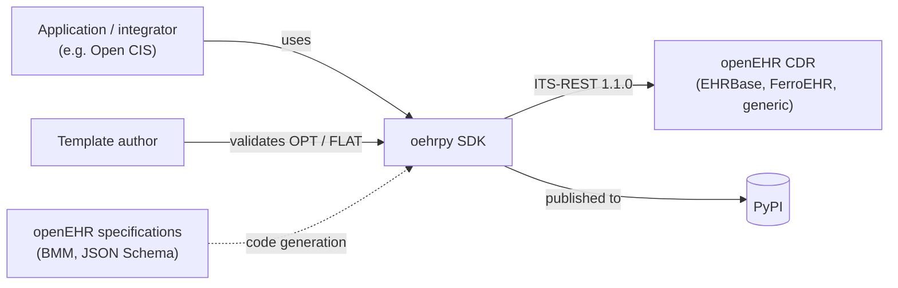
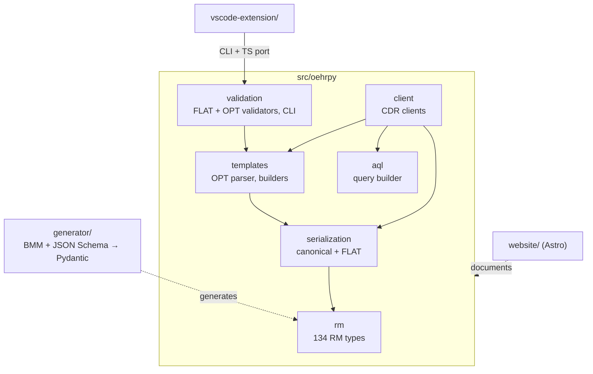
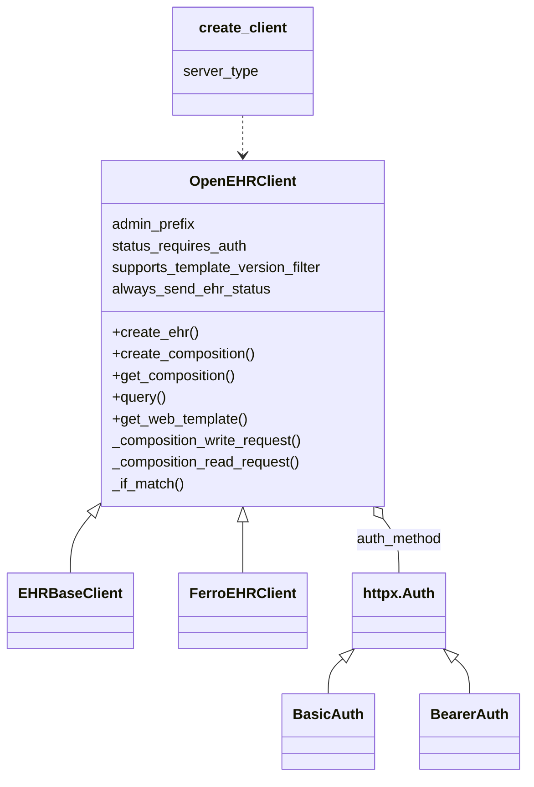
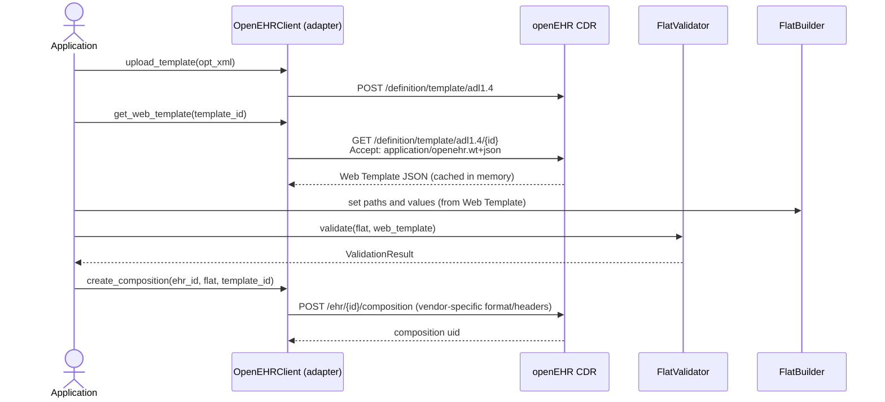
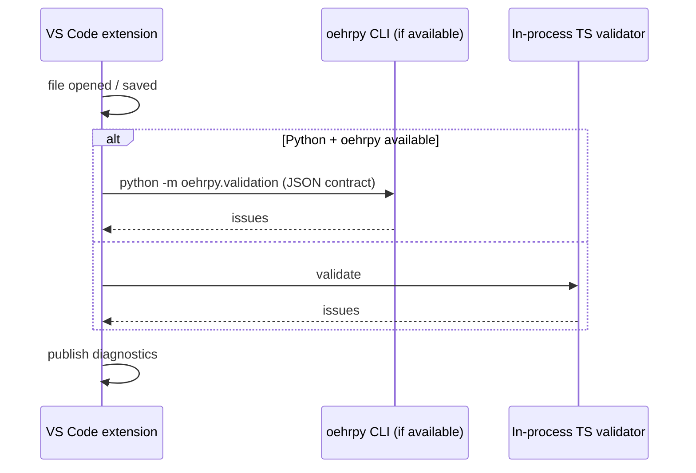
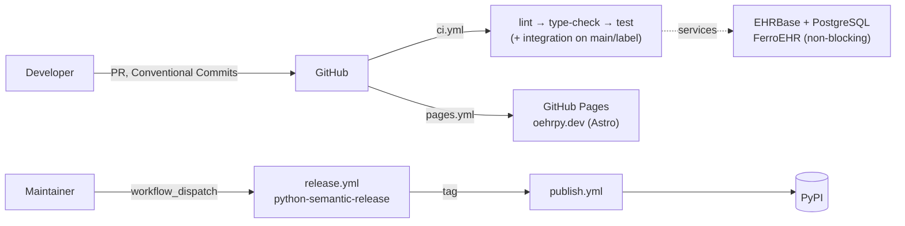
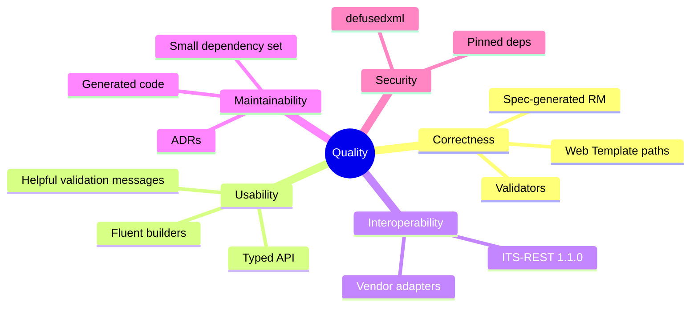

# oehrpy Architecture Documentation (arc42)

This document describes the architecture of **oehrpy**, following the
[arc42](https://arc42.org/) template (12 sections). Detailed decisions live in
the [ADRs](../adr/); this document gives the overview and links to them.

Diagrams use [Mermaid](https://mermaid.js.org/), which GitHub renders inline.

| # | Section |
|---|---------|
| 1 | [Introduction and Goals](#1-introduction-and-goals) |
| 2 | [Constraints](#2-constraints) |
| 3 | [Context and Scope](#3-context-and-scope) |
| 4 | [Solution Strategy](#4-solution-strategy) |
| 5 | [Building Block View](#5-building-block-view) |
| 6 | [Runtime View](#6-runtime-view) |
| 7 | [Deployment View](#7-deployment-view) |
| 8 | [Cross-cutting Concepts](#8-cross-cutting-concepts) |
| 9 | [Architecture Decisions](#9-architecture-decisions) |
| 10 | [Quality Requirements](#10-quality-requirements) |
| 11 | [Risks and Technical Debt](#11-risks-and-technical-debt) |
| 12 | [Glossary](#12-glossary) |

---

## 1. Introduction and Goals

oehrpy (`pip install oehrpy`, import name `oehrpy`, see
[ADR-0006](../adr/0006-align-import-name-with-pypi-package-name.md)) is a Python
SDK for [openEHR](https://specifications.openehr.org/). It fills a gap in the
ecosystem: there is no comprehensive, actively maintained Python SDK for
openEHR. Product requirements: [PRD-0000](../prd/PRD-0000-python-openehr-sdk.md).

### 1.1 Requirements overview

| ID | Requirement |
|----|-------------|
| R1 | Type-safe Python classes for the openEHR Reference Model (RM 1.1.0) with validation |
| R2 | (De)serialize RM objects to openEHR canonical JSON |
| R3 | Build and parse compositions in the FLAT (simplified) format |
| R4 | Parse OPT 1.4 templates and extract template metadata |
| R5 | Talk to openEHR CDRs over ITS-REST 1.1.0 (EHR, EHR_STATUS, COMPOSITION, CONTRIBUTION, DIRECTORY, templates, AQL, stored queries) |
| R6 | Support EHRBase and FerroEHR without vendor branching in user code |
| R7 | Build AQL queries with a fluent, type-safe API |
| R8 | Validate FLAT compositions against Web Templates and validate OPT files, from Python and from VS Code |

### 1.2 Quality goals

| Priority | Goal | Motivation |
|----------|------|------------|
| 1 | **Correctness / spec conformance** | Clinical data: wrong paths or types silently corrupt records. Spec-driven generation and Web-Template-derived paths reduce hand-written guesswork. |
| 2 | **Type safety and developer experience** | Pydantic v2 models, mypy strict, fluent builders catch errors before the CDR does. |
| 3 | **Vendor neutrality / extensibility** | New CDRs should need a thin adapter, not a fork. |
| 4 | **Maintainability** | Small dependency set, generated RM code, ADRs, automated releases. |
| 5 | **Reproducibility / supply-chain hygiene** | Exact-pinned dependencies, controlled CVE exposure. |

### 1.3 Stakeholders

| Role | Expectation |
|------|-------------|
| Application developers (e.g. Open CIS) | Stable, typed API; easy FLAT composition and AQL |
| Template authors / modellers | Fast feedback on OPT and FLAT validity (CLI, VS Code) |
| CDR operators / vendors (EHRBase, FerroEHR) | Spec-conformant requests; documented vendor quirks |
| Maintainers / contributors | Clear structure, CI, on-demand releases |

---

## 2. Constraints

### 2.1 Technical

| Constraint | Background |
|------------|-----------|
| Python ≥ 3.10 | Modern typing (`X \| None`, `list[str]`); CI covers 3.10–3.13 |
| Pydantic v2 for the RM | Validation and (de)serialization of 134 RM types |
| `httpx` for HTTP, async-first | Client API is `async` |
| `defusedxml` for XML | OPT files are untrusted input |
| Runtime deps limited to pydantic, httpx, defusedxml | Small footprint; the generator uses only stdlib + these |
| All dependencies exact-pinned in `pyproject.toml` | Reproducible builds, CVE control |
| RM 1.1.0 is the only supported RM version | [ADR-0001](../adr/0001-odin-parsing-and-rm-1.1.0-support.md) |
| FLAT paths come from Web Templates, never from OPT XML | [ADR-0005](../adr/0005-web-template-as-primary-source-of-truth-for-flat-paths.md) |
| Generated RM lives in a single module (`rm_types.py`) | Avoids circular imports among 134 mutually referencing classes |

### 2.2 Organizational and conventions

| Constraint | Background |
|------------|-----------|
| Apache-2.0 license | |
| Conventional Commits for PR titles | python-semantic-release derives versions/changelog from commits |
| No manual version bumps or `CHANGELOG.md` edits | [ADR-0004](../adr/0004-python-semantic-release-for-release-automation.md), [ADR-0010](../adr/0010-on-demand-releases.md) |
| Decisions recorded as ADRs | [ADR-0000](../adr/0000-record-architecture-decisions.md) |
| Quality gates: ruff, mypy (strict), pytest, pre-commit | [ADR-0003](../adr/0003-pre-commit-hooks-for-code-quality.md) |

---

## 3. Context and Scope

### 3.1 Business context

| Partner | Inputs to oehrpy | Outputs from oehrpy |
|---------|------------------|---------------------|
| Application code | Python calls, RM objects, FLAT dicts | Typed RM objects, FLAT/canonical JSON, query results |
| openEHR CDR | JSON/XML REST responses, Web Templates | REST requests (compositions, AQL, templates, admin) |
| openEHR specifications | BMM / JSON Schema | Generated Pydantic RM classes (build time) |
| Template author | OPT 1.4 XML, FLAT JSON | Validation reports (CLI / VS Code diagnostics) |

### 3.2 Technical context

| Interface | Technology | Notes |
|-----------|------------|-------|
| SDK → CDR | HTTP(S) via `httpx.AsyncClient`, JSON (XML for OPT upload) | Basic or Bearer auth, pluggable (`auth_method`, `admin_auth_method`) |
| SDK → filesystem | OPT XML files | Parsed with `defusedxml` |
| CLI | `oehrpy-validate-opt`, `python -m oehrpy.validation` | Emits JSON; consumed by the VS Code extension |
| Distribution | PyPI wheel (hatchling) | Published by `publish.yml` |

### 3.3 Scope

**In scope:** RM types, serialization (canonical, FLAT), OPT parsing and
validation, Web-Template-based FLAT validation, CDR clients, AQL builder, code
generator, VS Code extension, project website.

**Out of scope:** running a CDR, OIDC token acquisition (callers supply tokens
or a token provider), persistence, UI, ADL 1.4/2 archetype authoring.

---

## 4. Solution Strategy

| Goal / problem | Strategy | Where |
|----------------|----------|-------|
| Spec conformance for 134 RM types | **Generate** Pydantic models from the openEHR JSON Schema / BMM instead of hand-writing them | `generator/` → `rm/rm_types.py` |
| Correct FLAT paths | Derive paths from the **Web Template** produced by the CDR; OPT is used for metadata only | ADR-0005, `validation/web_template.py`, `serialization/flat.py` |
| Multiple CDRs | **Generic ITS-REST client + thin vendor adapters** overriding hooks/class attributes, not `if server_type` branches | ADR-0011, `client/` |
| Authentication variety | Pluggable `httpx.Auth`-compatible auth methods; token acquisition stays with the caller | `client/auth.py` |
| Early error detection | Pydantic validation, mypy strict, FLAT/OPT validators, fluent builders | `validation/`, `aql/`, `templates/` |
| Same validation in Python and editor | Python CLI as source of truth, in-process TypeScript port with shared JSON contract and parity tests | ADR-0007, ADR-0008 |
| Confidence against real CDRs | Unit tests always; integration tests against Dockerized EHRBase / FerroEHR | ADR-0002 |
| Low release friction | Commit-driven versioning, releases cut on demand | ADR-0004, ADR-0010 |

---

## 5. Building Block View

### 5.1 Level 1: whitebox overview

| Building block | Responsibility |
|----------------|----------------|
| `rm` | Pydantic v2 models for openEHR RM 1.1.0 (UPPERCASE names such as `DV_QUANTITY` to match the spec) |
| `serialization` | Canonical JSON ↔ RM (`_type` discriminators); FLAT paths, context and builder |
| `templates` | OPT 1.4 parser (metadata only), builder skeleton generator, pre-built template builders |
| `validation` | `FlatValidator` (against Web Templates, per-platform rules) and `OPTValidator` (well-formedness, semantics, FLAT path impact); CLI entry point |
| `aql` | Fluent AQL builder avoiding string concatenation |
| `client` | Async ITS-REST client, vendor adapters, auth, factory |
| `generator` | Build-time code generation of `rm_types.py` |
| `vscode-extension` | OPT/FLAT diagnostics in the editor |
| `website` | Public site and docs (Astro, GitHub Pages; ADR-0009) |

*Dependencies point downward in the diagram: `rm` has no internal dependencies;
no module imports the generator, which is build-time only.*

### 5.2 Level 2: `client`

| Module | Responsibility |
|--------|----------------|
| `openehr.py` | Vendor-neutral `OpenEHRClient`/`OpenEHRConfig`, errors (`OpenEHRError`, `AuthorizationError`), response dataclasses, in-memory Web Template cache |
| `ehrbase.py` | `EHRBaseClient`: `format` query parameter, unquoted `If-Match`, admin API at `/rest/admin`; re-exports historical names for backward compatibility |
| `ferroehr.py` | `FerroEHRClient`: unauthenticated JSON `/rest/status`, requires `EHR_STATUS.archetype_details`, `version=*` template listing, admin API at `/rest/openehr/v1/admin` |
| `auth.py` | `BasicAuth`, `BearerAuth` (static token or sync/async provider) |
| `contribution.py` | CONTRIBUTION request/response modelling |
| `factory.py` | `create_client(server_type=…)`, `detect_server_type()` |

### 5.3 Level 2: `validation`

| Module | Responsibility |
|--------|----------------|
| `__init__.py` | `FlatValidator` facade (`from_web_template(wt, platform=…)`) |
| `web_template.py` | `parse_web_template`, `enumerate_valid_paths`: derives the valid FLAT path set |
| `path_checker.py` | `validate_composition`: path/index/suffix checks, returns `ValidationResult` with `ValidationError`/`ValidationInfo` |
| `platforms.py` | `PlatformDialect` per platform (`ehrbase`, `better`) |
| `required_fields.py`, `suggestions.py` | Required-field checks, "did you mean" suggestions |
| `opt/` | `OPTValidator` for OPT 1.4 XML |
| `__main__.py` | `python -m oehrpy.validation` JSON CLI (ADR-0007) |

---

## 6. Runtime View

### 6.1 Create a composition from a template (FLAT)

The adapter decides *how* the FLAT payload is transmitted (EHRBase: `format`
and `templateId` query parameters; spec-following CDRs: media type and
`openehr-template-id` header). Application code is identical for both.

### 6.2 AQL query

`AQLBuilder` builds an `AQLQuery` (query string + parameters) → `client.query(...)` →
`POST /query/aql` → `QueryResponse` (columns, rows; pagination via
`LIMIT`/`OFFSET`).

### 6.3 OPT validation in VS Code

Both backends honour the same JSON contract; parity is tested (ADR-0007,
ADR-0008).

### 6.4 Code generation (build time)

`python -m generator.pydantic_generator` → `json_schema_parser`/`bmm_parser` →
`pydantic_generator` → `src/oehrpy/rm/rm_types.py`.

---

## 7. Deployment View

oehrpy is a library; it is *deployed* as a PyPI package, not run as a service.

| Environment | Setup |
|-------------|-------|
| Local development | `pip install -e ".[dev]"`; optional `docker-compose up -d` for EHRBase 2.0.0 + PostgreSQL 16.2, `docker compose --profile ferroehr up -d --wait ferroehr` for FerroEHR (port 8081) |
| CI | GitHub Actions; unit tests on every PR; integration tests on pushes to `main`/`develop` and PRs labeled `integration` (service containers) |
| Release | Manual `Release` workflow derives version + changelog from commits ([RELEASING.md](../../RELEASING.md)) |
| Website | `website/` built and deployed by `pages.yml` |

The target CDR is selected for integration tests with `OEHRPY_CDR=ehrbase|ferroehr`.

---

## 8. Cross-cutting Concepts

### 8.1 Domain model
RM classes mirror the openEHR RM 1.1.0 specification, including `DV_SCALE` and
`DV_CODED_TEXT.preferred_term`. Naming follows the spec (UPPERCASE), enforced by
per-file ruff ignores for generated code.

### 8.2 Serialization formats
- **Canonical JSON**: lossless, `_type`-discriminated.
- **FLAT**: dot/slash-separated keys, `:n` indices, `|attribute` suffixes,
  `ctx/*` context. The format changed in EHRBase 2.x; see
  [FLAT Format Versions](../FLAT_FORMAT_VERSIONS.md) and
  [FLAT learnings](../flat-format-learnings.md).

### 8.3 Source of truth for paths
Web Template JSON from the CDR, not OPT XML (ADR-0005). `get_web_template()`
caches in memory per template.

### 8.4 Vendor variation
Isolated in adapter hooks and class attributes (ADR-0011). Base client contains
no `if server_type` branches. Backward compatibility: all names previously
importable from `oehrpy.client` / `oehrpy.client.ehrbase` remain.

### 8.5 Error handling
`OpenEHRError` is the base for CDR errors (`EHRBaseError` is an alias);
HTTP 403 raises `AuthorizationError`. Validators return result objects with
structured issues (code, path, message, suggestion) instead of raising.

### 8.6 Security
- Untrusted XML parsed with `defusedxml`.
- Credentials via config/`auth_method`; no token acquisition or storage in the SDK.
- Exact-pinned dependencies and CVE monitoring.

### 8.7 Testing
Unit tests per component (`tests/test_*.py`), `pytest-asyncio` for the client,
integration suite in `tests/integration/` against real CDRs with
`@pytest.mark.integration` and `@pytest.mark.ferroehr_xfail(reason=…)` for
known FerroEHR bugs (ADR-0002, `docs/integration-testing-journey.md`).

### 8.8 Code quality
ruff (lint + format), mypy strict, pre-commit hooks (ADR-0003), CI gating.

### 8.9 Release and versioning
Semantic versioning derived from Conventional Commits; releases on demand
(ADR-0004, ADR-0010).

### 8.10 Concurrency
The client is async (`httpx.AsyncClient`) and used as an async context manager;
models and builders are synchronous and side-effect free.

---

## 9. Architecture Decisions

| ADR | Decision |
|-----|----------|
| [0000](../adr/0000-record-architecture-decisions.md) | Record architecture decisions |
| [0001](../adr/0001-odin-parsing-and-rm-1.1.0-support.md) | ODIN parsing and RM 1.1.0 as the supported model |
| [0002](../adr/0002-integration-testing-with-ehrbase.md) | Integration testing with a real EHRBase |
| [0003](../adr/0003-pre-commit-hooks-for-code-quality.md) | Pre-commit hooks for code quality |
| [0004](../adr/0004-python-semantic-release-for-release-automation.md) | python-semantic-release for release automation |
| [0005](../adr/0005-web-template-as-primary-source-of-truth-for-flat-paths.md) | Web Template is the source of truth for FLAT paths |
| [0006](../adr/0006-align-import-name-with-pypi-package-name.md) | Import name `oehrpy` matches the PyPI name |
| [0007](../adr/0007-dual-backend-flat-validation.md) | Dual-backend FLAT validation (Python CLI + TypeScript) |
| [0008](../adr/0008-opt-validation-via-python-cli-in-vscode.md) | OPT validation in VS Code via the Python CLI |
| [0009](../adr/0009-astro-for-github-pages-site.md) | Astro for the GitHub Pages site |
| [0010](../adr/0010-on-demand-releases.md) | On-demand releases |
| [0011](../adr/0011-vendor-adapters-for-openehr-cdrs.md) | Vendor adapters over a generic ITS-REST client |

New decisions: add the next numbered ADR and link it here.

---

## 10. Quality Requirements

### 10.1 Quality tree

### 10.2 Quality scenarios

| ID | Scenario | Expected response |
|----|----------|-------------------|
| Q1 | A developer builds a FLAT composition with a misspelled path | `FlatValidator` reports the path with a suggestion before submission |
| Q2 | A project switches from EHRBase to FerroEHR | Only `create_client("ferroehr", …)` and auth config change; builders and FLAT payloads stay the same |
| Q3 | A new CDR with small deviations is to be supported | A subclass overriding hooks/class attributes; no change to the base client |
| Q4 | A maliciously crafted OPT file is parsed | Parsed with `defusedxml`; no entity-expansion or external-entity processing |
| Q5 | EHRBase changes behaviour in a new release | Integration suite in CI detects it; vendor hook adjusts |
| Q6 | The RM spec gets a patch release | Regenerate `rm_types.py`; diff reviewed; unit tests run |
| Q7 | A VS Code user has no Python environment | In-process TypeScript validator gives equivalent diagnostics (parity tested) |
| Q8 | An existing user upgrades oehrpy | Historical import names still work (no breaking change from ADR-0011) |

---

## 11. Risks and Technical Debt

| # | Risk / debt | Impact | Mitigation |
|---|-------------|--------|-----------|
| 1 | **Vendor FLAT inconsistencies**: EHRBase 2.x FLAT differs from older docs and from the spec | Wrong payloads | ADR-0005, FLAT docs, integration tests; see `docs/ehrbase-issues/` |
| 2 | **Two validator implementations** (Python and TypeScript) can diverge | Inconsistent diagnostics | Shared JSON contract, parity tests (ADR-0007) |
| 3 | **Only RM 1.1.0** supported | Users on RM 1.0.x servers rely on backward compatibility | Documented in ADR-0001 |
| 4 | **FerroEHR integration is non-blocking in CI** and has known bugs | Regressions may go unnoticed | `ferroehr_xfail` markers; promote to blocking once stable |
| 5 | **Large single-module client** (`openehr.py`, ~1.9k lines) | Harder to navigate | Candidate for splitting by resource (EHR, composition, query, admin) |
| 6 | **Large generated `rm_types.py`** | Slow IDE, noisy diffs | Single module is deliberate (circular references); regenerate only on spec change |
| 7 | **Builder coverage is limited** (pre-built builders cover few templates; OPT-derived builders are metadata skeletons) | Users hand-assemble FLAT for other templates | Generate builders from Web Templates |
| 8 | **Alpha status** (`Development Status :: 3 - Alpha`) | API may still change | Conventional Commits and changelog signal breaking changes |
| 9 | **In-memory Web Template cache** has no invalidation | Stale paths if a template is replaced during a long-lived process | Cache keyed per client; recreate client or clear cache after template changes |
| 10 | **Third-party CDR coverage** (Better, EHRServer) is not yet implemented | Limited reach | Generic `OpenEHRClient` is usable; add adapters on demand |

---

## 12. Glossary

| Term | Definition |
|------|------------|
| **openEHR** | Open specification for health records, separating information model (RM) from clinical content models (archetypes/templates) |
| **RM** | Reference Model: the generic information model (COMPOSITION, OBSERVATION, DV_* …) |
| **Archetype / Template** | Clinical content constraints on the RM; templates combine archetypes for a use case |
| **OPT** | Operational Template: a flattened, XML-serialized template (ADL 1.4) |
| **Web Template** | CDR-generated JSON description of an OPT, including the valid FLAT paths |
| **Canonical JSON** | Standard openEHR JSON serialization with `_type` fields |
| **FLAT format** | Simplified, path-keyed composition format (`ctx/language`, `vitals/bp:0/systolic\|magnitude`) |
| **CDR** | Clinical Data Repository: a server storing openEHR data |
| **EHRBase** | Open-source openEHR CDR |
| **FerroEHR** | Spec-strict ITS-REST 1.1.0 CDR |
| **ITS-REST** | openEHR REST API specification |
| **AQL** | Archetype Query Language |
| **BMM** | Basic Meta-Model: machine-readable specification of the RM |
| **ADR** | Architecture Decision Record |
| **arc42** | Template for architecture documentation (<https://arc42.org/>) |
